# KRIYA — Furniture E-commerce Platform

KRIYA is a single-vendor, IKEA-style furniture store built for the Indonesian market. Customers browse flat-pack furniture room by room, pick a color/size variant, check out with a shipping quote and coupon, and pay through Midtrans. Store staff run the whole shop from an admin panel: catalog, inventory, orders, shipping, promotions, reviews, returns and sales reports.

The storefront is bilingual (Bahasa Indonesia / English) and comes with an AI customer-support chatbot (in progress) that answers from a store knowledge base and can look up order status.

> **Demo project.** All product data is synthetic and payments run on the **Midtrans Sandbox**, so no real money changes hands.

---

## Table of Contents

- [Screenshots](#screenshots)
- [Features](#features)
- [Tech Stack](#tech-stack)
- [Architecture](#architecture)
- [Project Structure](#project-structure)
- [Getting Started](#getting-started)
- [API Overview](#api-overview)
- [Development Guidelines](#development-guidelines)
- [Deployment](#deployment)

---

## Screenshots

### Storefront

<table>
  <tr>
    <th>Home</th>
    <th>Category</th>
    <th>Product Detail</th>
  </tr>
  <tr>
    <td>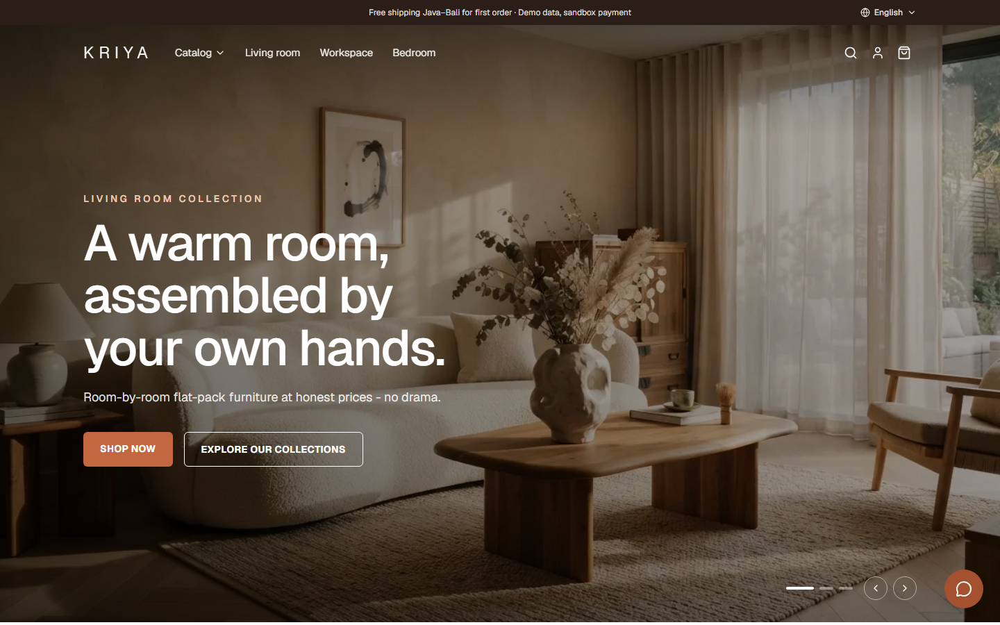</td>
    <td>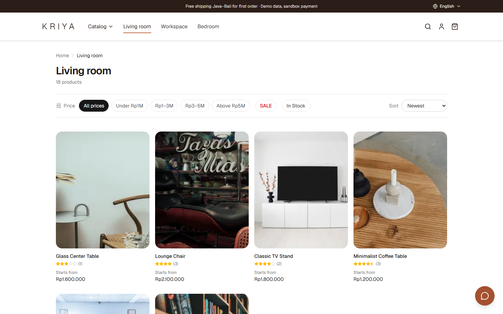</td>
    <td>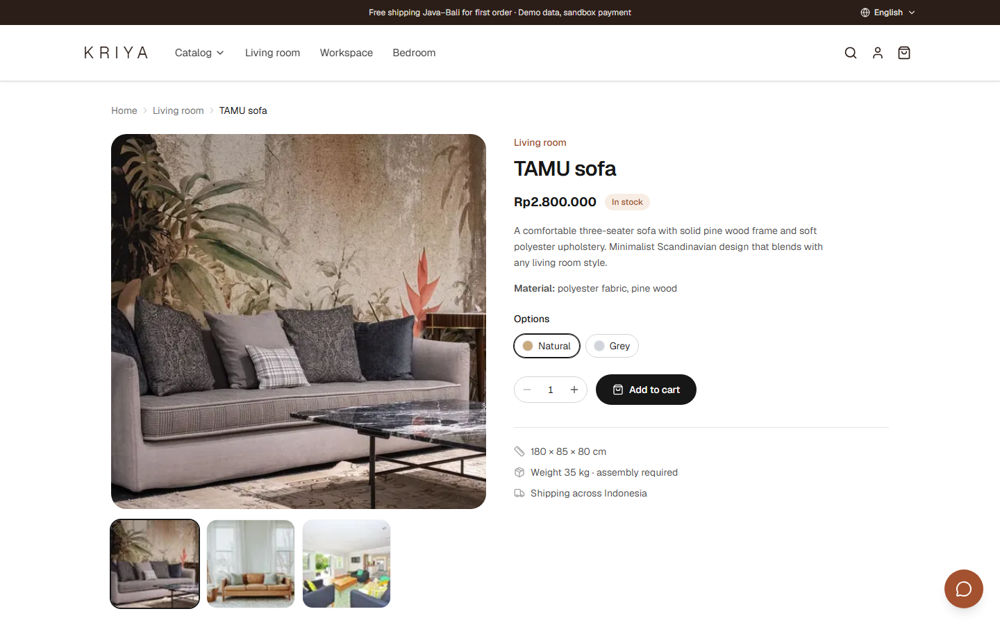</td>
  </tr>
  <tr>
    <th>Cart</th>
    <th>My Orders</th>
    <th>Login</th>
  </tr>
  <tr>
    <td>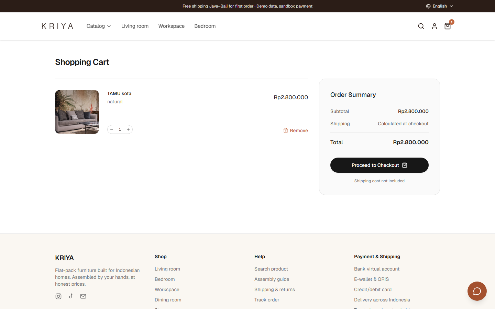</td>
    <td>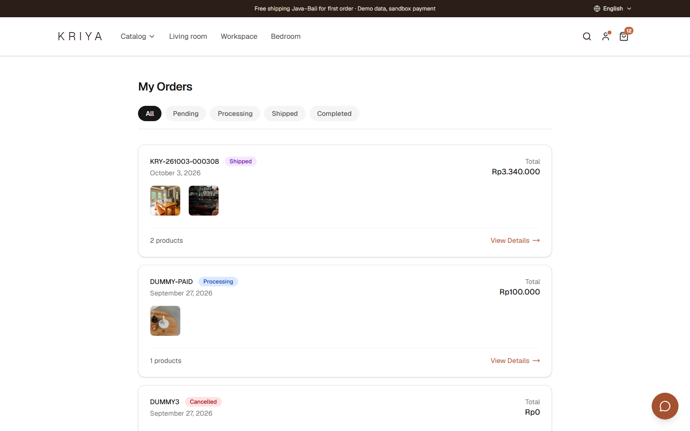</td>
    <td>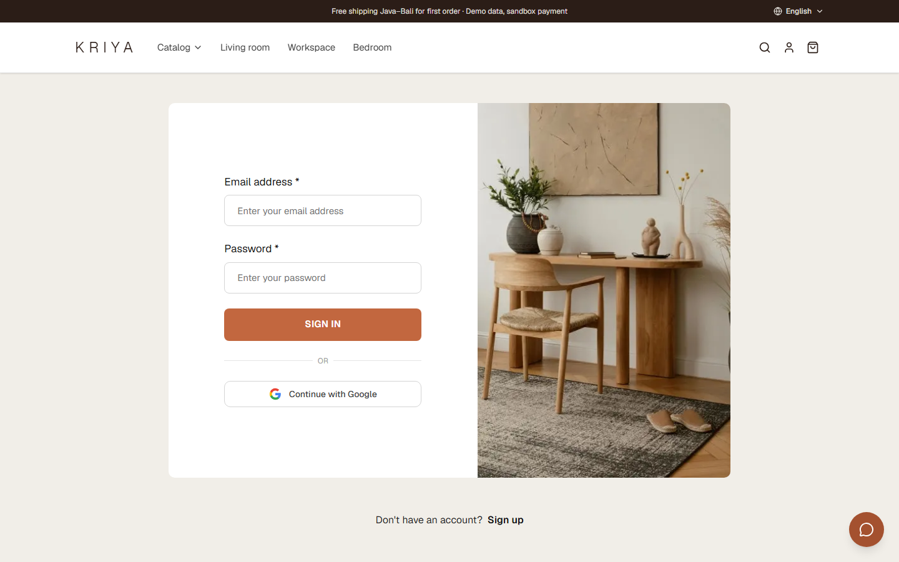</td>
  </tr>
</table>

### Admin Panel

<table>
  <tr>
    <th>Dashboard</th>
    <th>Orders</th>
    <th>Products</th>
  </tr>
  <tr>
    <td>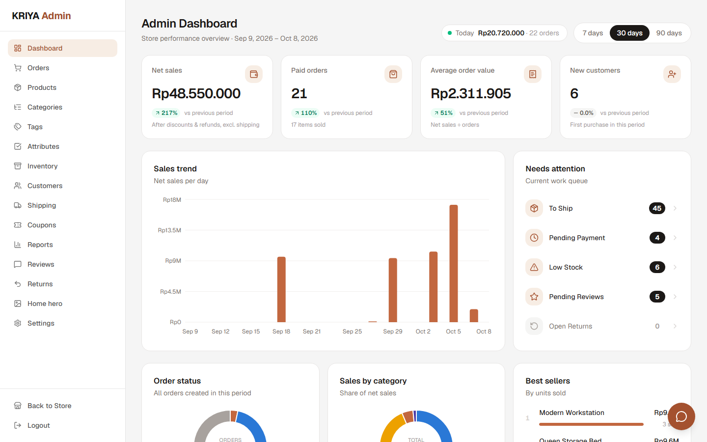</td>
    <td>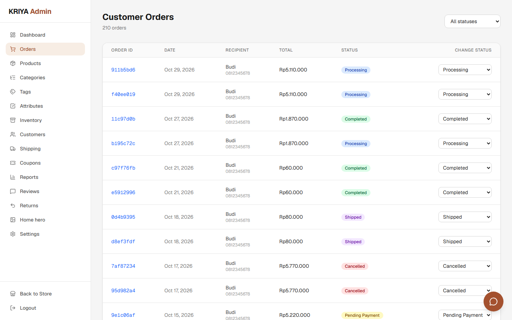</td>
    <td>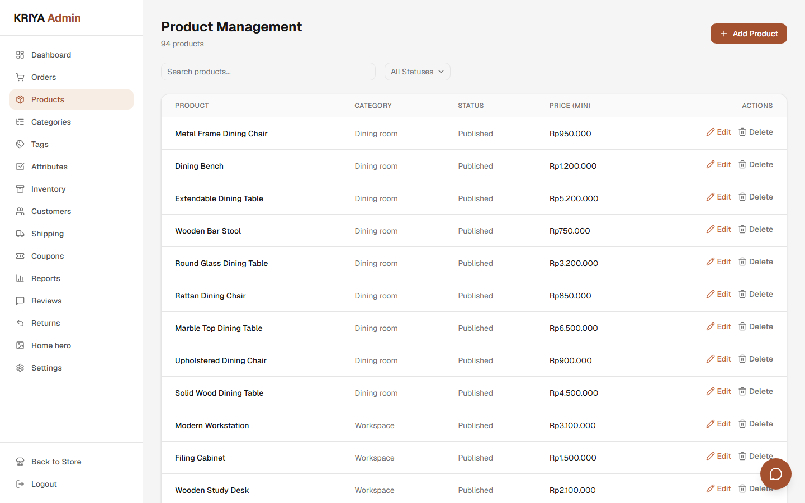</td>
  </tr>
  <tr>
    <th>Inventory</th>
    <th>Reports</th>
    <th>Coupons</th>
  </tr>
  <tr>
    <td>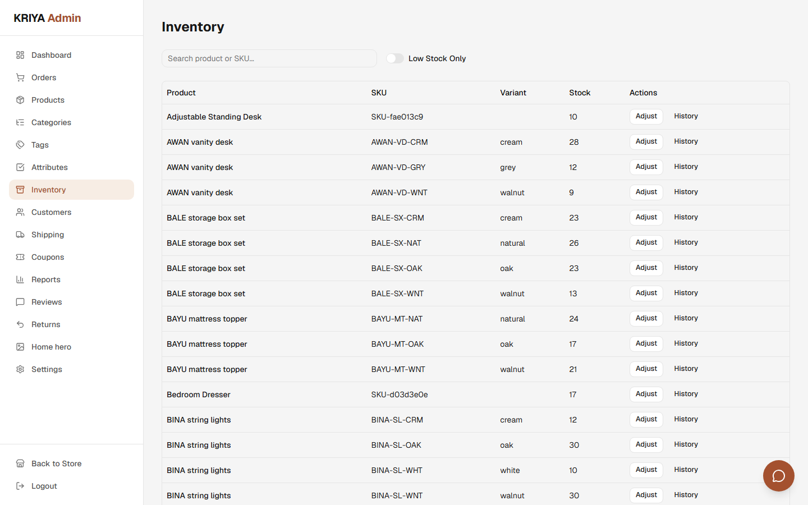</td>
    <td>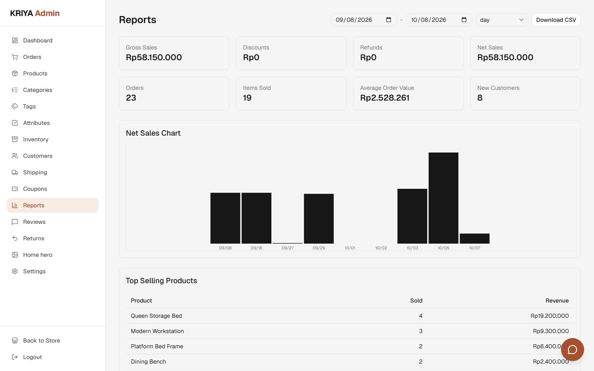</td>
    <td>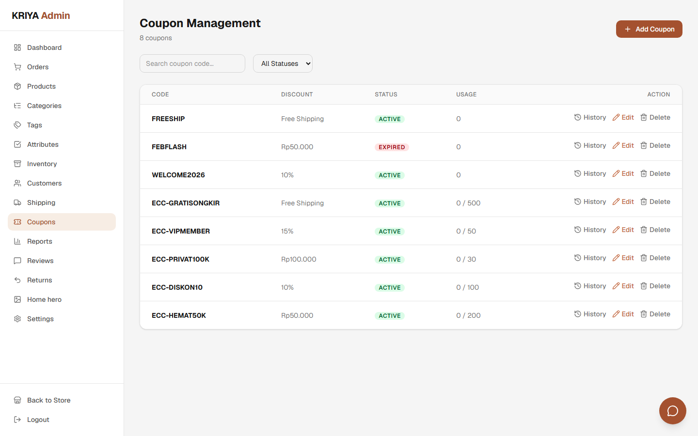</td>
  </tr>
</table>

### Chatbot Workflow (n8n)

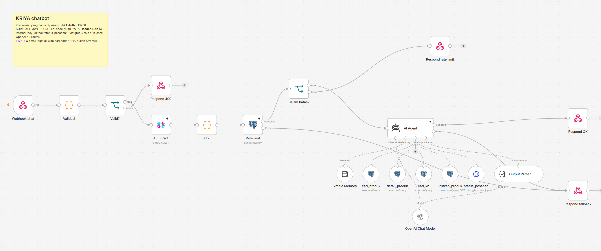

Each chat message from the web widget goes through these steps:

1. **Webhook chat → Validasi → Valid?** receives the message and validates the payload. An invalid request gets a `400` response.
2. **Auth JWT** verifies the user's Supabase token (HS256). **Ctx** then builds the request context: the locale and the signed-in user's email.
3. **Rate limit → Dalam batas?** counts the user's usage in Postgres. A user who goes over the limit gets a rate-limit response.
4. **AI Agent** answers the message using an OpenAI-compatible chat model, a short conversation memory and a structured output parser. It can call these tools:
   - `cari_produk`, `detail_produk`, `urutkan_produk`: search, show and sort products from the catalog (read-only Postgres role)
   - `cari_kb`: full-text/trigram search over the bilingual knowledge base (FAQ, policies, assembly guides)
   - `status_pesanan`: order status lookup through the API's internal endpoint
5. **Respond OK** returns the answer. If anything fails, **Respond fallback** returns a safe fallback message instead.

The workflow export lives in [`automation/n8n/chatbot.json`](automation/n8n/chatbot.json).

---

## Features

### Storefront (customer)

- **Bilingual UI and content** (ID/EN): the language switcher covers both UI text and product content.
- **Catalog**: hierarchical categories, price/sale/in-stock filters, sorting, keyword search.
- **Product detail**: image gallery, color/size variants, dimensions & materials, assembly guide, ratings and reviews.
- **Cart**: guest cart that is merged into the account on sign-in, server-side price calculation and stock validation.
- **Checkout**: address book, table-based shipping rates per zone, coupon codes, deterministic price quote.
- **Payment**: Midtrans Snap (Sandbox) with a payment deadline, "pay again" for pending orders, and automatic expiry.
- **After-sales**: order history and tracking, printable invoice, product reviews, return requests, in-app notifications.
- **Auth**: email/password and Google sign-in through Supabase Auth.
- **Support chatbot** *(in progress)*: answers questions from the store knowledge base and checks order status.

### Admin panel

- **Dashboard**: net sales, paid orders, AOV, new customers, sales trend, and a "needs attention" work queue.
- **Orders**: status transitions, courier and tracking number, internal notes.
- **Catalog**: products with variants and images, categories, tags, attributes and facet terms.
- **Inventory**: stock per variant, low-stock filter, manual adjustments recorded in a stock ledger.
- **Customers**: customer list with purchase history.
- **Shipping**: zones and tiered rates.
- **Coupons**: percentage, fixed amount and free-shipping coupons with usage limits and redemption history.
- **Reports**: sales summary, time series, top products, CSV export.
- **Reviews and returns**: moderation, admin replies, return approval and refunds.
- **Storefront content**: home hero slides and store settings.

The admin panel is at `/admin` and only accounts with the `admin` role can use it.

---

## Tech Stack

| Layer | Technology |
|---|---|
| Frontend | Next.js 16 (App Router), React 19, TypeScript (strict), Tailwind CSS 4, shadcn/ui, TanStack Query, Zustand, Recharts |
| Backend | Go 1.25, Gin, GORM (models only; schema managed with SQL migrations) |
| Database, auth and storage | Supabase: PostgreSQL, Supabase Auth (JWT), Supabase Storage |
| Payment | Midtrans Snap (Sandbox) |
| Chatbot and automation | n8n (self-hosted, Docker), an OpenAI-compatible LLM, PostgreSQL full-text + trigram search over a bilingual knowledge base |
| Testing | Go `testing`, Playwright (end-to-end) |

---

## Architecture

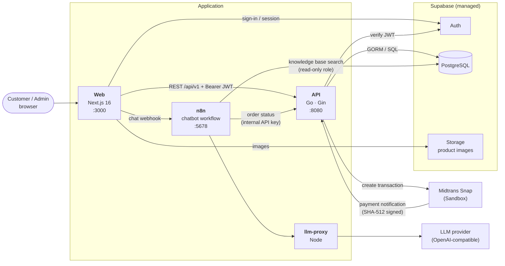

**How the pieces fit together**

- **Web (`apps/web`)** renders the storefront and admin panel. It uses Supabase only for sign-in and sessions (plus Storage uploads in the admin panel). Everything else goes through the Go API with the user's JWT as a Bearer token.
- **API (`services/api`)** owns all business rules: catalog, cart, checkout quotes, orders, inventory reservations, coupons, after-sales and reports. Each business domain is its own Go package, and they share an HTTP envelope (`{"data": ...}` / `{"error": {...}}`) and snake_case JSON.
- **Payments** follow the Midtrans Snap flow. The API creates the transaction and reserves stock, the browser opens the Snap popup, and Midtrans calls the notification webhook. The API verifies the SHA-512 signature before it updates the order. A background sweeper expires unpaid orders after their deadline and releases the reserved stock.
- **Chatbot (`automation/`)** is an n8n workflow that receives messages from the web widget. It searches a bilingual knowledge base in Postgres (FAQ, policies, assembly guides) using full-text and trigram search, calls the API's internal endpoint for order status, and sends the prompt to the LLM. `llm-proxy` is a small Node proxy that forces non-streaming responses from the LLM endpoint.
- **Database schema** is managed with forward-only SQL migrations in `supabase/migrations/`. GORM is used for models only, never `AutoMigrate`.

### Checkout and payment flow

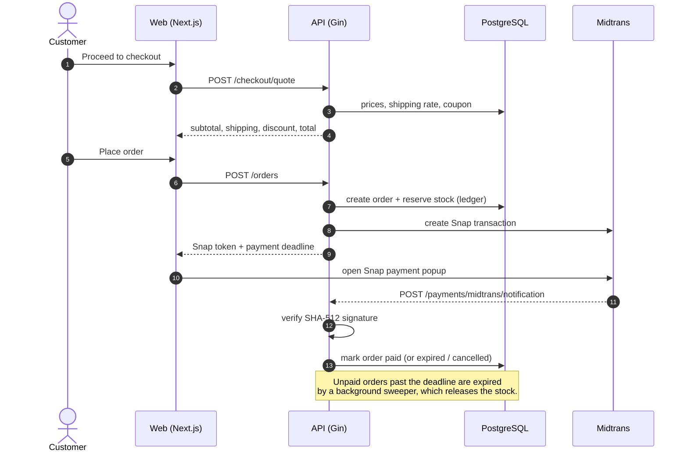

---

## Project Structure

```
kriya-ecommerce/
├── apps/web/                 # Next.js storefront + admin panel
│   ├── app/(store)/          #   customer pages (home, catalog, cart, checkout, orders, account)
│   ├── app/(admin)/admin/    #   admin panel pages
│   ├── app/(auth)/           #   login, register, OAuth callback
│   ├── components/           #   UI components (shadcn/ui + KRIYA components)
│   └── lib/                  #   API clients, queries, i18n, stores — one folder per domain
├── services/api/             # Go REST API
│   ├── cmd/api/              #   API server entrypoint
│   ├── cmd/seed/             #   catalog seeder (reads data/seed/products.json)
│   └── internal/             #   catalog, customer, checkout, promo, aftersales, orderflow, hero, ...
├── automation/
│   ├── n8n/                  # exported n8n workflows (chatbot, chat usage cleanup)
│   └── llm-proxy/            # proxy that forces non-streaming LLM responses
├── data/                     # seed catalog, knowledge base (id/en), prompts, data scripts, chatbot eval
├── supabase/
│   ├── migrations/           # forward-only SQL migrations (001 … 017)
│   └── seed/                 # optional sample data (catalog, customers, promos, after-sales)
├── e2e/                      # Playwright end-to-end tests
├── docs/                     # plans, agent guides, DevOps plans, screenshots, session notes
├── docker-compose.yml        # local n8n + llm-proxy
└── dev.ps1                   # one-command local dev launcher (Windows / PowerShell)
```

---

## Getting Started

### Prerequisites

- [Node.js](https://nodejs.org/) 20.9+ and [pnpm](https://pnpm.io/)
- [Go](https://go.dev/doc/install) 1.25+
- [Docker Desktop](https://www.docker.com/products/docker-desktop/), only needed for the chatbot (n8n)
- [psql](https://www.postgresql.org/download/) for applying migrations
- Accounts:
  - a [Supabase](https://supabase.com/) project (Postgres, Auth, Storage)
  - a [Midtrans](https://midtrans.com/) **Sandbox** account (server and client keys)
  - *(optional, chatbot)* an OpenAI-compatible LLM endpoint and API key

### 1. Clone the repository

```bash
git clone <repository-url> kriya-ecommerce
cd kriya-ecommerce
```

### 2. Configure environment variables

```bash
cp .env.example .env
cp .env.example apps/web/.env.local
```

Fill in the values. The most important ones:

| Variable | Used by | Description |
|---|---|---|
| `NEXT_PUBLIC_SUPABASE_URL`, `NEXT_PUBLIC_SUPABASE_ANON_KEY` | web | Supabase project URL and anon key |
| `NEXT_PUBLIC_API_URL` | web | Go API base URL (default `http://localhost:8080`) |
| `NEXT_PUBLIC_CHAT_WEBHOOK_URL` | web | n8n chat webhook (default `http://localhost:5678/webhook/kriya-chat`) |
| `NEXT_PUBLIC_USE_FIXTURES` | web | `true` = use built-in mock data with no backend; `false` = use the real API |
| `SUPABASE_DB_URL` | api | Postgres connection string (Supabase pooler) |
| `SUPABASE_URL`, `SUPABASE_JWT_SECRET` | api | used to verify Supabase access tokens |
| `MIDTRANS_SERVER_KEY`, `MIDTRANS_CLIENT_KEY` | api | Midtrans Sandbox keys |
| `WEB_ORIGIN` | api | allowed CORS origin (default `http://localhost:3000`) |
| `INTERNAL_API_KEY` | api, n8n | shared secret for internal service-to-service endpoints |
| `LLM_BASE_URL`, `LLM_API_KEY`, `LLM_MODEL` | n8n | OpenAI-compatible LLM for the chatbot |
| `N8N_ENCRYPTION_KEY` | n8n | encrypts stored n8n credentials (generate once and keep it) |

> Never commit `.env` files. Secrets live only in `.env` and in n8n's credential store.

### 3. Set up the database

Apply the migrations in order:

```bash
for f in supabase/migrations/*.sql; do
  psql "$SUPABASE_DB_URL" -v ON_ERROR_STOP=1 -f "$f"
done
```

> Migration `014_chatbot.sql` creates a least-privilege `n8n_chat` role. Set its password manually afterwards; it is intentionally kept out of git:
> `ALTER ROLE n8n_chat LOGIN PASSWORD '<long-random-password>';`

### 4. Seed the catalog

```bash
cd services/api
go run ./cmd/seed          # loads data/seed/products.json
cd ../..
```

Optional sample data (customers, coupons, reviews, returns) for a fuller demo:

```bash
for f in supabase/seed/ec-v2/*.sql; do psql "$SUPABASE_DB_URL" -f "$f"; done
```

To use the admin panel, set `role = 'admin'` on your user's row in the `profiles` table.

### 5. Run the application

**Option A: one command (Windows / PowerShell)**

```powershell
./dev.ps1            # add -Install to force a dependency install
```

`dev.ps1` loads `.env`, starts n8n + llm-proxy in Docker (if `N8N_ENCRYPTION_KEY` is set) and opens the web and API in separate terminals.

**Option B: manually**

```bash
# Terminal 1 — API (env vars from .env must be exported)
cd services/api
go run ./cmd/api

# Terminal 2 — Web
cd apps/web
pnpm install
pnpm dev

# Optional — chatbot
docker compose up -d n8n llm-proxy
```

| Service | URL |
|---|---|
| Storefront | http://localhost:3000 |
| Admin panel | http://localhost:3000/admin |
| API health check | http://localhost:8080/healthz |
| n8n editor | http://localhost:5678 |

### 6. Set up the chatbot (optional)

1. Open n8n at http://localhost:5678 and import `automation/n8n/chatbot.json` (and `chat_usage_cleanup.json`).
2. In n8n, create credentials for Postgres (the `n8n_chat` role), the LLM endpoint and `INTERNAL_API_KEY`, then activate the workflow.
3. Load the knowledge base into the `kb_articles` table:

   ```bash
   python data/scripts/load_kb.py > kb_load.sql
   psql "$SUPABASE_DB_URL" -f kb_load.sql
   ```

### 7. Test Midtrans payments locally

Midtrans has to reach the notification webhook. To test the full payment flow locally, expose the API with a tunnel (e.g. `ngrok http 8080`). Then set the **Payment Notification URL** in the Midtrans Sandbox dashboard to:

```
https://<your-tunnel>/api/v1/payments/midtrans/notification
```

Use the [Midtrans Sandbox test cards / e-wallets](https://docs.midtrans.com/docs/testing-payment-on-sandbox) to complete a payment.

### Running tests

```bash
# Backend unit tests
cd services/api && go test ./...

# Frontend lint + type check / build
cd apps/web && pnpm lint && pnpm build

# End-to-end tests (Playwright; config at the repo root, starts the web dev server automatically)
cd e2e && pnpm install && pnpm exec playwright install chromium && cd ..
e2e/node_modules/.bin/playwright test
```

---

## API Overview

Base path: `/api/v1`. Every response uses a JSON envelope: `{"data": ...}` on success and `{"error": {"code", "message"}}` on failure. Lists include `meta` (`page`, `limit`, `total`). Prices are integer rupiah. Most catalog endpoints accept `?lang=en|id`.

<details>
<summary><b>Public</b></summary>

| Method | Path | Description |
|---|---|---|
| GET | `/categories` | Hierarchical category tree |
| GET | `/products` | Product listing with filters, sort and pagination |
| GET | `/products/:slug` | Product detail with variants, attributes and effective (sale) price |
| GET | `/products/:slug/related` | Upsell / cross-sell products |
| GET | `/products/:slug/reviews` | Approved reviews and rating summary |
| GET | `/tags`, `/attributes` | Tags and facet attributes |
| GET | `/coupons/public` | Active public coupons |
| POST | `/coupons/validate` | Validate a coupon and preview the discount |
| GET | `/shipping/provinces` | Province reference data for shipping |
| GET | `/store` | Public store settings |
| GET | `/hero-slides` | Home page hero slides |

</details>

<details>
<summary><b>Customer (requires <code>Authorization: Bearer &lt;jwt&gt;</code>)</b></summary>

| Method | Path | Description |
|---|---|---|
| GET, PUT | `/profile` | Customer profile |
| GET, POST, PUT, DELETE | `/addresses` | Address book, default address |
| GET, PUT | `/cart` | Server-side cart with totals and stock validation |
| POST | `/cart/merge` | Merge the guest cart on sign-in |
| POST | `/checkout/quote` | Subtotal, shipping and discount quote |
| POST | `/orders` | Create an order, reserve stock, get a Snap token |
| GET | `/orders`, `/orders/:id` | Order history and detail |
| POST | `/orders/:id/pay` | Resume payment with a fresh Snap token |
| POST | `/orders/:id/cancel` | Cancel an unpaid order |
| GET | `/me/reviews`, `/me/reviewables` | My reviews and purchased items awaiting review |
| POST, PUT | `/reviews`, `/reviews/:id` | Write and edit product reviews |
| POST | `/orders/:id/returns` | Submit a return request |
| GET | `/returns`, `/returns/:id` | Track return requests |
| GET, POST | `/notifications`, `/notifications/unread-count`, `/notifications/read` | In-app notifications |

</details>

<details>
<summary><b>Admin (<code>/admin/*</code>, requires the <code>admin</code> role)</b></summary>

| Path | Description |
|---|---|
| `/admin/stats` | Dashboard metrics |
| `/admin/orders` | Fulfillment, courier and tracking number, status transitions |
| `/admin/products`, `/admin/categories`, `/admin/tags`, `/admin/attributes` | Catalog management |
| `/admin/inventory` | Stock list, movement history, manual adjustments |
| `/admin/customers` | Customers and purchase history |
| `/admin/shipping` | Shipping zones and rates |
| `/admin/coupons` | Coupons and redemption logs |
| `/admin/reports/*` | Sales summary, time series, top products |
| `/admin/reviews`, `/admin/returns` | Review moderation, returns and refunds |
| `/admin/hero-slides` | Home hero editor |

</details>

<details>
<summary><b>Webhooks and internal</b></summary>

| Method | Path | Description |
|---|---|---|
| POST | `/payments/midtrans/notification` | Midtrans payment notification (SHA-512 signature check) |
| GET | `/internal/orders/status` | Order status lookup for the chatbot (requires `INTERNAL_API_KEY`) |

</details>

---

## Development Guidelines

- **No `any`**: no `any` in TypeScript, no `interface{}` in Go payloads, no `typing.Any` in Python. Don't silence the linter or type checker (`as any`, `@ts-ignore`, `eslint-disable`).
- **JSON is snake_case** for every request and response field.
- **Schema changes go through migrations.** Add a new numbered SQL file under `supabase/migrations/`; never use GORM `AutoMigrate`.
- **The frontend never queries Supabase tables directly.** All data goes through the Go API. The only exceptions are auth and admin Storage uploads.
- Before committing:
  - frontend: `pnpm lint && pnpm build` in `apps/web`
  - backend: `go build ./... && go vet ./... && go test ./...` in `services/api`

Detailed contracts and conventions are in [`docs/agents/KRIYA-MASTER.md`](docs/agents/KRIYA-MASTER.md). Feature plans are in [`docs/rencana/`](docs/rencana/).

---

## Deployment

The deployment infrastructure (container images, CI/CD and hosting) is **being rebuilt from scratch**. The current plans are in [`docs/devops/`](docs/devops/). For now the project runs in local development mode as described above.
